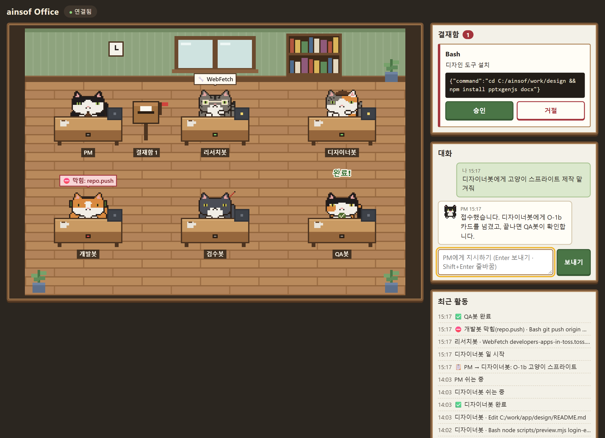
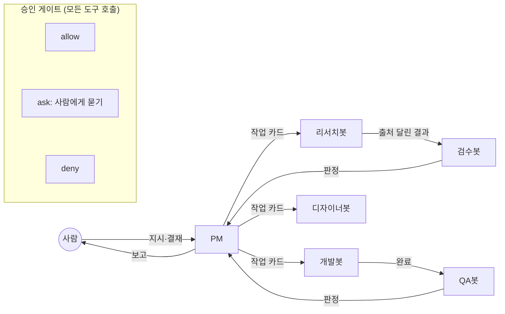

# ainsof Office

Claude Code 위에서 **역할이 다른 AI 봇 여섯**(PM·리서치·개발·검수·QA·디자이너)에게 일을 나눠 맡기고, 위험한 동작은 **코드로 된 승인 게이트**가 허용·승인 요청·차단으로 판정하는 멀티에이전트 작업 방식입니다. 혼자 개발하면서 실제 앱 작업에 쓰고 있습니다.

> **English summary.** A Claude Code plugin that runs six role-scoped agents (PM, researcher, developer, reviewer, QA, designer). Every tool call passes a deterministic approval gate (allow / ask / deny) written in code, not in prompts. Includes a localhost "pixel office" page for live reporting, commands and approvals. MIT licensed. Windows-first.



## 왜 만들었나

봇에게 프롬프트로 "하지 마"라고 쓰는 건 부탁일 뿐입니다. 웹 글에 숨은 지시에 속은 봇은 그 부탁을 어깁니다. 그래서 세 가지를 코드로 정했습니다.

1. **역할마다 쓸 수 있는 도구를 좁힌다.** 웹 글을 읽는 검수봇에게는 로컬 파일·명령 도구를 주지 않는다(Rule of Two).
2. **모든 도구 호출을 게이트가 판정한다.** 비밀 파일·푸시·설치·외부 발행은 막고, 새 의존성·외부 통신·개인정보는 사람에게 묻는다.
3. **결과는 만든 봇이 아닌 봇이 채점한다.** 개발봇의 결과는 QA봇이 실행으로, 조사 결과는 검수봇이 원문 대조로 확인한다.

## 구조



| 봇 | 하는 일 | 못 하는 일 (게이트가 막음) |
|---|---|---|
| PM (`operator`) | 지시를 작업 카드로 나눠 배정하고 보고 | 코드 쓰기, 웹 보기 |
| 리서치봇 | 웹 조사 | 로컬 파일·명령 |
| 개발봇 | 작업 저장소에서 코드·테스트 | 넘김 저장소의 `bot/*` 밖으로 푸시, 비밀 파일, 설치 |
| 검수봇 | 출처 URL 원문을 열어 주장과 대조 | 로컬 파일·명령·WebFetch(요약을 거쳐 원문 보장이 안 됨) |
| QA봇 | 완료 기준을 실행으로 확인 | `qa/` 밖 쓰기, 허용 목록 밖 명령 |
| 디자이너봇 | 레퍼런스 수집 → DESIGN.md → 시안 → pptx·docx | 디자인 폴더 밖 쓰기, 허용 사이트 밖 브라우징 |

규칙은 [plugin/gate/rules.mjs](plugin/gate/rules.mjs), 판정은 [plugin/gate/decide.mjs](plugin/gate/decide.mjs)에 있습니다. 판정에는 LLM을 쓰지 않습니다.

## 실제로 써 본 결과

- **2026-10-14 ~ 10-24 운영 기록:** 봇의 도구 호출 815건 중 사람이 직접 본 것은 49건(승인 요청 20, 차단 29)이었습니다.
- **레드팀 165건:** 숨은 지시에 속은 봇이 비밀 파일을 읽거나, 게이트 설정을 고치거나, 자기 승인을 하려는 경우 등을 [tests/redteam-cases.mjs](tests/redteam-cases.mjs)에 고정했습니다. `npm test`로 전부 돌립니다.
- **같은 조사 과제를 봇 회사 3회 vs 혼자 3회:** 출처 오류는 둘 다 0, 비용은 평균 $2.13 vs $1.93(API 요금 환산)이었습니다. **회사 쪽이 더 잘한다는 증거는 없었습니다.** 사람 손이 덜 가는 것이 이득이었고, 순서대로 하는 일은 나눠도 이득이 적었습니다.

## 설치 (간단 설치)

Windows 기준입니다. macOS·Linux는 아직 시험하지 않았습니다.

**준비:** [Claude Code](https://code.claude.com), Node.js 18 이상, git

1. 플러그인 설치 (Claude Code 안에서)
   ```
   /plugin marketplace add ain0633/ainsof-office
   /plugin install ainsof-office@ainsof
   ```
2. 작업 저장소를 `C:\ainsof\work\<이름>` 에 둡니다. 봇 지시문이 이 위치를 씁니다.
3. 그 폴더에서 PM 세션을 켭니다.
   ```powershell
   cd C:\ainsof\work\<이름>
   claude --agent ainsof-office:operator
   ```
   이제 PM에게 말로 지시하면 작업 카드가 만들어지고 봇에게 넘어갑니다. 게이트는 플러그인 훅으로 이 회사 봇(`ainsof-office:*`)의 호출만 보고, 다른 Claude Code 세션은 건드리지 않습니다. 기록은 `C:\ainsof\log` 에 남습니다.

**사무실 페이지 (선택)**
```powershell
git clone https://github.com/ain0633/ainsof-office.git C:\ainsof\src
claude mcp add --scope user office -- node C:\ainsof\src\plugin\channel\office.mjs
claude --agent ainsof-office:operator --dangerously-load-development-channels server:office
```
- 브라우저에서 http://127.0.0.1:7777 을 열고, `C:\ainsof\office-pairing.txt` 의 6자리 코드를 넣습니다.
- Claude Code Channels가 연구 미리보기라 시작 옵션과 시작 확인이 필요합니다.

**디스코드 알림 (선택):** `C:\ainsof\secrets.json` 에 `{"discordWebhook": "<웹후크 URL>"}` 을 쓰면 승인 요청·차단·배정이 디스코드로 옵니다. 짝짓기 코드도 파일 대신 디스코드로 옵니다.

### 간단 설치의 한계

간단 설치는 봇이 **사람과 같은 윈도 계정**으로 일합니다. 게이트는 명령 글자를 보고 판정하므로, 경로를 조각내 조립하는 식의 꼼수까지는 못 막습니다. 즉 **실수 방지 수준**입니다.

| | 간단 설치 | 단단한 설치 |
|---|---|---|
| 봇 계정 | 사람과 같은 계정 | 봇 전용 표준 사용자 계정 |
| 게이트 위치 | 플러그인 안 | 관리자 폴더 + 관리자 정책(managed-settings) |
| 봇이 게이트를 끌 수 있나 | 꼼수를 쓰면 가능 | 윈도 권한이 막음 |
| 사람의 문서를 볼 수 있나 | 파일 자체는 열 수 있음(게이트 규칙만 막음) | 윈도 권한이 막음 |
| 설치 시간 | 몇 분 | 30분~1시간, 관리자 권한 |

실제 저장소와 토큰을 봇에게 오래 맡길 거라면 [단단한 설치](docs/단단한-설치.md)를 권합니다. 지은이는 이 방식으로 운영합니다.

## 재생 데모

**바로 보기:** https://ain0633.github.io/ainsof-office/plugin/channel/web/?replay=1

사무실 페이지는 기록 파일을 다시 재생할 수 있습니다. 서버 없이 정적 파일로 열립니다. 내 PC에서 열려면:

```powershell
cd plugin\channel\web
npx serve .        # 또는 python -m http.server
# http://localhost:3000/?replay=1
```

샘플 기록([sample-events.jsonl](plugin/channel/web/sample-events.jsonl))은 실제 운영 기록의 흐름을 본떠 경로와 이름을 일반화한 것입니다. 기록 형식은 [이벤트 로그 v1](docs/이벤트-로그-v1.md)에 있습니다.

## 테스트

```
npm test
```
게이트 판정, 가림(키·개인정보), 레드팀, 사무실 채널(가짜 Claude Code와 가짜 웹후크로 처음부터 끝까지), 설치 스크립트를 시험합니다. 의존성이 없어 `npm install` 이 필요 없습니다.

## 폴더

```
plugin/                 Claude Code 플러그인
  agents/               봇 여섯의 지시문
  skills/               작업 카드, 조사 결과, 검수, 회고, 디자인 기획·출력
  gate/                 승인 게이트(판정·가림·기록)
  hooks/hooks.json      간단 설치용 게이트 훅
  channel/              사무실 페이지(MCP 채널 서버 + 웹)
company-lock/           단단한 설치(관리자 설치 스크립트, managed-settings)
scripts/                봇 계정 준비·시작·점검 스크립트(단단한 설치용)
tests/                  node --test
```

## 한계와 다음 계획

- 게이트는 글자 수준 판정입니다. 근본 대책인 네트워크 차단(샌드박스)은 아직 없습니다.
- 생산성은 아직 과제 하나로만 쟀습니다. 카드마다 비용·사람 개입·재작업을 자동으로 세는 성적표가 다음 일입니다.
- 봇 지시문이 Windows 경로(`C:\ainsof`)를 씁니다. 경로를 설정으로 빼는 일이 남았습니다.
- 한국어 지시문입니다.

## 만든 방식

설계, 게이트 규칙, 검증 기준, 운영 판단은 지은이가 했고, 구현은 Claude Code와 함께 했습니다. 개발 기록(2026-10-12부터 커밋 100여 개)은 비공개 작업 저장소에 있고, 이 저장소는 그중 공개할 부분만 옮긴 것입니다.

## 라이선스

[MIT](LICENSE)
